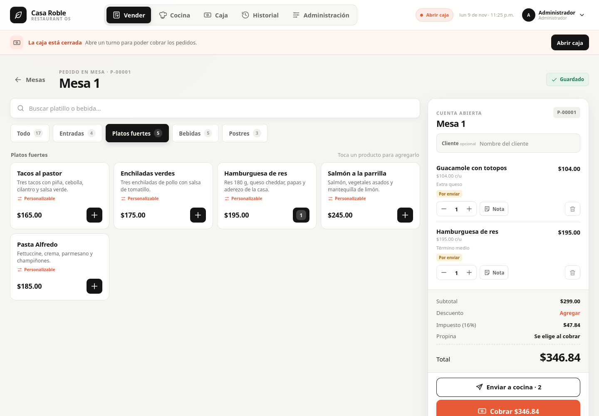

# Casa Roble POS

Sistema de punto de venta para restaurante con diseño táctil moderno, inspirado en la claridad de Square y la operación de Toast. Incluye salón, pedidos para llevar y delivery, cocina en pantalla, caja con turnos, pagos mixtos, modificadores, roles por PIN, pedidos en línea e impresión térmica ESC/POS.

Frontend **Next.js/React**, API **Express** y persistencia local con **SQLite** (`node:sqlite`), sin servicios externos obligatorios.



## Funcionalidad

### Venta y salón
- Mesas por área (salón principal y terraza), con estado libre/ocupada, consumo, artículos y tiempo abierto.
- Pedidos para llevar y delivery desde el POS, con teléfono y dirección de entrega.
- Catálogo por categorías, búsqueda instantánea, alta de productos con un toque, cantidades, notas por producto y notas generales del pedido.
- **Fotos de productos** en el menú del POS y en la página pública de pedidos.
- **Carga masiva de productos por CSV**, con creación de categorías y actualización de productos existentes.
- **Inventario real**: insumos, entradas de mercancía, ajustes, movimientos y recetas que descuentan ingredientes al vender.
- Etiquetas claras de servicio: **Comer aquí**, **Para llevar** y **Delivery** en mesas, caja, cocina, tickets y reportes.
- Autoguardado del pedido con llaves de línea idempotentes.
- Descuentos por porcentaje o monto y propina por porcentaje o monto.
- Historial de pedidos y consulta del ticket.

### Cobro
- Pagos en efectivo, tarjeta u otros.
- **Pagos parciales y mixtos**: el pedido permanece abierto hasta cubrir el saldo; cada pago queda registrado con su método, monto, efectivo recibido y cambio.
- **Métodos de pago administrables**: efectivo, tarjeta, SINPE Móvil, transferencia y métodos personalizados; se pueden activar o desactivar.
- **Comprobantes fotográficos** para SINPE Móvil y transferencias, guardados con el pago.
- **Factura pública compartible y envío por WhatsApp** desde el cobro, el ticket y el historial.
- Bloqueo de edición cuando existe un pago parcial.
- Cálculo de cambio y ticket imprimible de 80 mm.
- Turnos de caja obligatorios para cobrar (configurable), fondo inicial, efectivo esperado, conteo y diferencia.

### Cocina (KDS)
- Pantalla `/cocina` con columnas **Nuevos**, **En preparación** y **Listos**.
- Actualización automática cada 5 segundos.
- Cambio de estado por platillo y por ticket.
- **Cocina integrada en el POS y en Caja**: una cola lateral de platillos permite marcar preparando/listo/servido sin abrir una pantalla separada y sin hacer scroll en el POS.
- Los cajeros también pueden usar el KDS completo si el restaurante no tiene una estación de cocina dedicada.
- Comandas con mesa, cliente, modificadores, notas y tiempo transcurrido.
- Envío a cocina desde el POS, conservando el estado de las líneas ya enviadas.

### Menú y administración
- CRUD de categorías y productos, con desactivación (nunca borrado destructivo).
- Grupos de modificadores con selección única/múltiple, mínimo, máximo, obligatoriedad y precio adicional.
- Asignación de grupos a cada producto.
- Administración de áreas y mesas, capacidad y activación.
- Equipo con roles `owner` (super admin), `admin` (gerente general), `manager`, `cashier`, `server` y `kitchen`.
- Jerarquía: solo el super admin crea o modifica métodos de pago y integraciones; el gerente general puede activarlos o desactivarlos.
- Ajustes de restaurante, pedidos en línea, costo de entrega y configuración de impresoras.

### Pedidos en línea
- Página pública `/pedir` con menú por categorías y personalización de productos.
- Modalidad **recoger en restaurante** y **entrega a domicilio**, activables por separado.
- Costo de entrega configurable.
- Los pedidos en línea entran al POS como pedidos abiertos, identificados como `online`.
- Límite anti-abuso de pedidos por IP.

### Operación y seguridad
- Acceso por empleado con PIN numérico de 4 a 8 dígitos; hash `scrypt` y sesiones con token aleatorio guardado como hash SHA-256.
- Cookie de sesión `HttpOnly`, `SameSite=Lax` y `Secure` en producción.
- Permisos por rol en la interfaz y en la API.
- Límite de intentos de PIN por empleado y por IP.
- Auditoría de accesos, cambios de pedido, pagos, cocina, equipo y catálogo.
- Impresión térmica directa por TCP (puerto 9100) para comandas y tickets, con papel de 58/80 mm; o impresión por el navegador para cualquier impresora instalada.
- Marca discreta **MATMAX IT Solutions** en el pie del sistema.
- Respaldos consistentes de SQLite.

## Producción

| Servicio | URL |
|---|---|
| POS | <https://totem.lapizzeria.food> |
| Pedidos en línea | <https://totem.lapizzeria.food/pedir> |
| Cocina | <https://totem.lapizzeria.food/cocina> |
| Panel Dokploy | <https://admin.lapizzeria.food> |

El POS usa autenticación propia por empleado. La página pública `/pedir` y los endpoints `/api/public/*` son los únicos accesibles sin sesión. La guía de operación, despliegue, respaldos y restauración está en [docs/DEPLOY-VPS.md](docs/DEPLOY-VPS.md).

## Stack

| Tecnología | Uso |
|---|---|
| **Next.js 16 + React 19** | Interfaz táctil, rutas y proxy `/api` al backend. |
| **Express 5** | API REST, sesiones, roles y validación. |
| **SQLite (`node:sqlite`)** | Persistencia en un archivo WAL, sin dependencias nativas. |
| **Zod** | Validación de entradas y mensajes en español. |
| **Vitest + Supertest** | Pruebas unitarias e integración HTTP contra SQLite en memoria. |
| **CSS propio** | Componentes, temas y diseño responsive sin librería de UI. |

Decisiones deliberadas:
- Importes siempre en **centavos enteros** y porcentajes en **puntos base**; nunca se confía en totales del cliente.
- No hay ORM: el esquema y las migraciones son explícitos y auditables.
- Las líneas de pedido conservan nombre y precio al momento de agregarse.
- El servidor es la única autoridad para precios, impuestos, descuentos, propinas y saldos.

## Requisitos

- Node.js **22.13+** (recomendado Node 24 LTS).
- npm 10+.
- Puertos libres: **3000** (web) y **4000** (API).

## Instalación y primer arranque

```bash
npm install --include=dev
npm run dev
```

Abre <http://localhost:3000>. En el primer arranque la base se crea y se carga el menú de ejemplo, áreas, mesas y grupos de modificadores. Como no hay empleados, `/login` muestra el formulario para **crear el primer administrador**.

Rutas útiles:

- POS: <http://localhost:3000>
- Cocina: <http://localhost:3000/cocina>
- Caja: <http://localhost:3000/caja>
- Historial: <http://localhost:3000/historial>
- Administración: <http://localhost:3000/admin>
- Pedidos en línea: <http://localhost:3000/pedir>
- API: <http://localhost:4000/api/health>

### Build de producción local

```bash
npm run build
npm start
```

La app queda en <http://localhost:3000>. Para usar cookies seguras necesitas HTTPS y `COOKIE_SECURE=true`; en HTTP local déjalo sin definir.

### Pruebas

```bash
npm test
```

Ejecuta **61 pruebas** con SQLite en memoria. Cubren precios, autenticación y roles, modificadores, cocina, pagos parciales, turnos, pedidos en línea, reportes, catálogo y documentos ESC/POS.

### Reiniciar datos de ejemplo

```bash
npm run db:reset
```

Borra ventas y pedidos locales y vuelve a cargar el menú y las mesas. Después deberás crear de nuevo el administrador.

### Crear la cuenta del propietario del software

El rol `owner` tiene su propio panel en `/owner` y puede administrar el nombre del restaurante, los métodos de pago y las integraciones.

```bash
npm run owner:create -w server -- "MATMAX Admin" 123456
```

En Docker se ejecuta dentro del contenedor del API. El propietario aparece en `/login` como un empleado más.

Desde el servidor o una copia de la base:

```bash
npm run admin:reset-pin -w server -- "Administrador" 123456
```

Restablece el PIN, reactiva la cuenta, la deja como `admin` y cierra sus sesiones activas. En Docker se ejecuta dentro del contenedor del API.

## Configuración

| Variable | Default | Descripción |
|---|---|---|
| `PORT` | `4000` | Puerto de la API. |
| `DATABASE_PATH` | `server/data/restpos.db` | Ruta del archivo SQLite. |
| `APP_TIMEZONE` | `America/Mexico_City` | Zona horaria del día de venta, reportes e impresión. |
| `TAX_RATE_BPS` | `1600` | Impuesto en puntos base (1600 = 16%). |
| `SESSION_TTL_HOURS` | `12` | Duración de la sesión de empleado. |
| `COOKIE_SECURE` | `false` | Debe ser `true` en producción con HTTPS. |
| `API_URL` | `http://127.0.0.1:4000` | Destino del proxy `/api` de Next.js. |
| `UPLOAD_DIR` | `<directorio de la base>/uploads` | Fotos de productos y comprobantes de pago. En Docker: `/data/uploads`. |

## Arquitectura

```text
Navegador / tablet / KDS / cliente en línea
              │
              ▼
        Next.js :3000
        ├── UI del POS
        ├── /cocina
        ├── /caja
        ├── /pedir  (público)
        └── /api/*  ── proxy ──▶  Express :4000
                                    ├─ sesiones + roles
                                    ├─ validación Zod
                                    ├─ pedidos y pagos parciales
                                    ├─ turnos y reportes
                                    ├─ KDS y modificadores
                                    ├─ impresión ESC/POS por TCP
                                    └─ SQLite /data/restpos.db
```

### Estructura

```text
.
├── Dockerfile                     # targets api y web
├── deploy/
│   ├── dokploy-compose.yml
│   ├── backup-restpos.sh
│   ├── restpos-firewall.sh
│   └── traefik-restpos.example.yml
├── docs/DEPLOY-VPS.md
├── shared/src/                    # precios y utilidades de dinero
├── server/
│   ├── src/
│   │   ├── app.js                 # rutas y middleware
│   │   ├── db.js                  # esquema, migraciones y seed
│   │   ├── auth.js                # PIN, sesiones y roles
│   │   ├── orders.js              # pedidos, pagos y comandas
│   │   ├── kitchen.js             # KDS
│   │   ├── shifts.js              # caja y arqueo
│   │   ├── modifiers.js
│   │   ├── public.js              # menú y pedidos en línea
│   │   ├── printer.js             # ESC/POS
│   │   ├── reports.js
│   │   └── settings.js
│   ├── scripts/
│   └── tests/
└── web/
    ├── app/
    │   ├── (pos)/                 # POS, cocina, caja, historial y admin
    │   ├── login/
    │   ├── pedir/                 # página pública
    │   └── recibo/[id]/
    ├── components/
    └── lib/
```

## Flujo de una venta

1. El empleado inicia sesión con su PIN; la API crea una sesión y emite una cookie segura.
2. Abre una mesa, un pedido para llevar o un delivery. También puede abrir un pedido recibido en línea.
3. Agrega productos; si el producto tiene grupos de modificadores, elige las opciones y el servidor calcula el precio de la línea.
4. El pedido se autoguarda. **Enviar a cocina** pasa las líneas pendientes a estado `sent` y aparecen en el KDS.
5. Cocina avanza cada platillo: `preparando` → `listo` → `servido`.
6. Caja abre un turno si es necesario. El cobro puede ser total o parcial; cada pago se registra y el saldo se actualiza.
7. Al cubrir el total, el pedido pasa a `pagada`, se libera la mesa y se puede imprimir el ticket.
8. El reporte diario agrupa ventas por método, categoría, empleado y hora; también se puede exportar a CSV.

## Modelo de datos principal

- `staff`, `sessions`: empleados, roles (`owner`, `admin`, `manager`, `cashier`, `server`, `kitchen`) y sesiones.
- `shifts`, `payments`, `payment_photos`: turnos, pagos parciales/mixtos y comprobantes.
- `payment_methods`: métodos configurables con tipo, icono y permiso de foto.
- `inventory_items`, `inventory_movements`, `product_ingredients`: stock, entradas, ajustes, consumos y recetas.
- `integrations`: conexiones externas preparadas para futuros conectores.
- `areas`, `restaurant_tables`: salón y mesas.
- `categories`, `products`: catálogo; `products.image_path` guarda la foto.
- `modifier_groups`, `modifiers`, `product_modifier_groups`, `order_item_modifiers`: opciones y snapshots.
- `orders`: cabecera, tipo, entrega, totales, saldo, origen y fechas.
- `order_items`: líneas con precio congelado, estado de cocina, curso y notas.
- `settings`, `audit_logs`: configuración y trazabilidad.

### Reglas de cálculo

```text
subtotal      = Σ (precio_unitario_con_modificadores × cantidad)
descuento     = porcentaje(subtotal) o monto fijo limitado al subtotal
base_gravable = subtotal − descuento
impuesto      = round_half_up(base_gravable × tasa)
total_sin_propina = base_gravable + impuesto
propina       = porcentaje(total_sin_propina) o monto fijo
total         = total_sin_propina + propina + costo_de_entrega
saldo         = total − pagos_registrados
```

- El costo de entrega no recibe impuesto ni propina.
- La propina no recibe impuesto.
- Un pago parcial no puede superar el saldo.
- En efectivo, el efectivo recibido debe cubrir el monto del pago; el cambio se calcula por pago.

## API

La API vive en `/api`. Los endpoints de autenticación y `/api/public/*` son públicos. El resto exige sesión.

| Método | Ruta | Descripción |
|---|---|---|
| `GET` | `/api/health` | Salud del servicio. |
| `GET` | `/api/auth/status` | Estado de configuración inicial y sesión. |
| `POST` | `/api/auth/setup` | Crea el primer administrador. |
| `POST` | `/api/auth/login` | Inicia sesión con `staffId` y PIN. |
| `POST` | `/api/auth/logout` | Cierra la sesión. |
| `GET` | `/api/catalog` | Menú con modificadores. |
| `GET` | `/api/tables` | Mesas y consumo abierto. |
| `POST` | `/api/orders` | Crea pedido de mesa, llevar o delivery. |
| `PATCH` | `/api/orders/:id/draft` | Reemplaza el contenido del pedido. |
| `POST` | `/api/orders/:id/send-kitchen` | Envía líneas pendientes a cocina. |
| `POST` | `/api/orders/:id/pay` | Registra pago total o parcial. |
| `POST` | `/api/orders/:id/cancel` | Anula un pedido sin pagos. |
| `GET` | `/api/kitchen/orders` | Tickets activos del KDS. |
| `PATCH` | `/api/kitchen/items/:id` | Cambia estado de un platillo. |
| `GET/POST` | `/api/shifts`, `/api/shifts/current`, `/api/shifts/:id/close` | Turnos y arqueo. |
| `GET/PATCH` | `/api/settings` | Configuración. |
| `GET/POST/PATCH` | `/api/staff`, `/api/staff/:id` | Equipo. |
| `GET/POST/PATCH` | `/api/modifier-groups`, `/api/admin/products/:id/modifier-groups` | Modificadores. |
| `GET/POST/PATCH` | `/api/admin/tables`, `/api/areas` | Salón. |
| `GET` | `/api/reports/daily`, `/api/reports/daily.csv` | Reporte y exportación. |
| `GET` | `/api/public/restaurant` | Menú público. |
| `GET` | `/api/public/product-images/:filename` | Foto pública de producto. |
| `POST` | `/api/public/orders` | Pedido en línea. |

## Alcance y límites

- **No procesa tarjetas**: registra el método de pago; la terminal bancaria es externa.
- **Facturación electrónica**: el ticket es interno; no sustituye la factura electrónica de Hacienda en Costa Rica.
- **Inventario:** se descuenta al cobrar solo si el producto tiene una receta configurada.
- **SQLite**: adecuado para una o pocas terminales en el mismo local. Para múltiples sucursales o alta concurrencia habría que migrar a PostgreSQL.
- **No hay sincronización offline**: el POS requiere conexión con la API.
- **Impresión térmica**: requiere una impresora ESC/POS accesible por TCP desde el contenedor del API.
